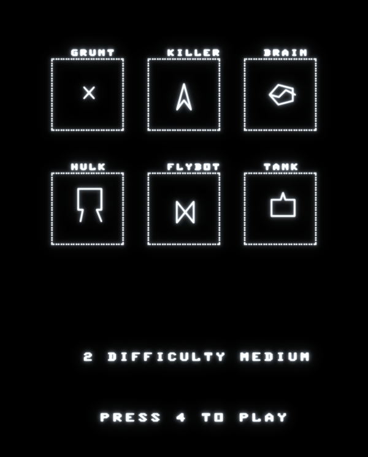
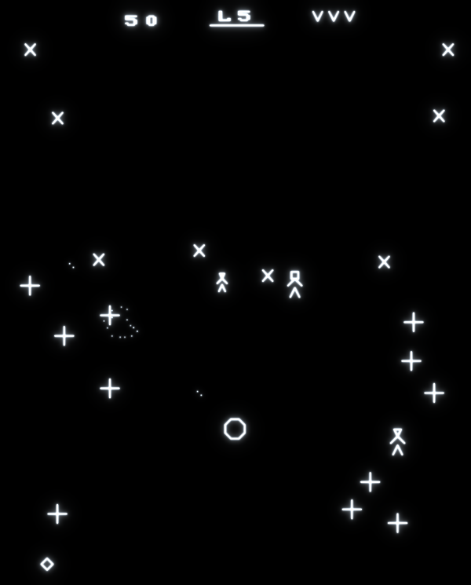
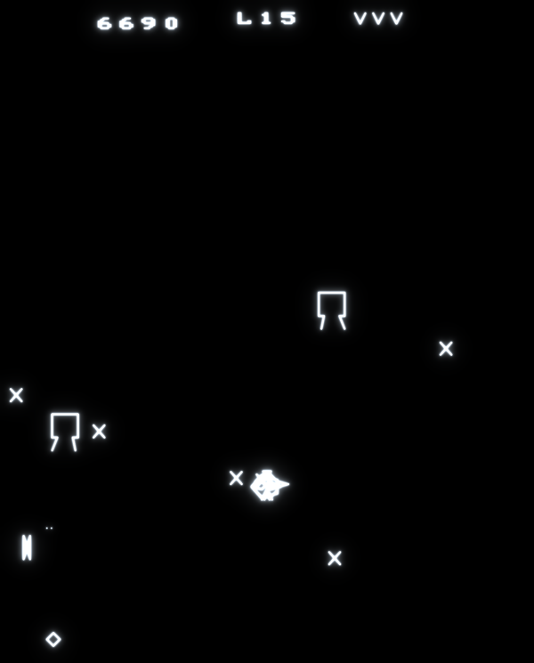
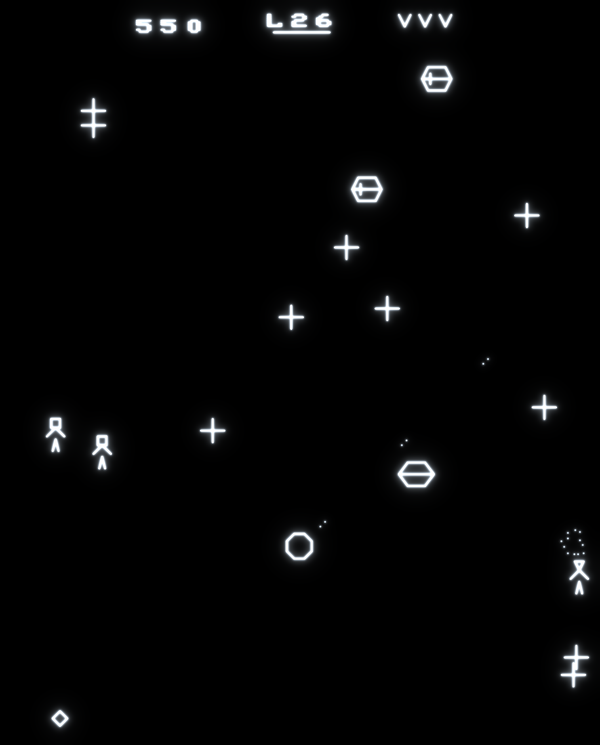
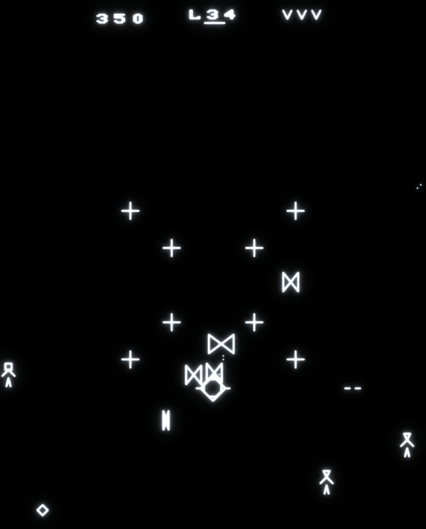
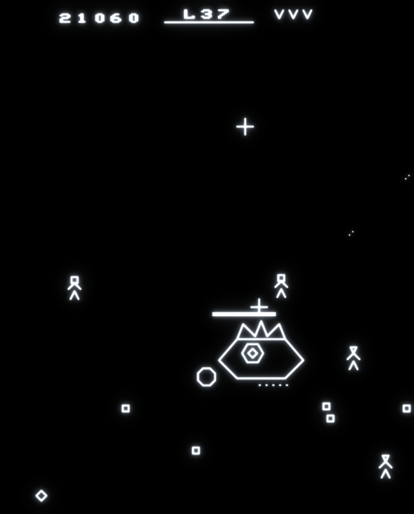
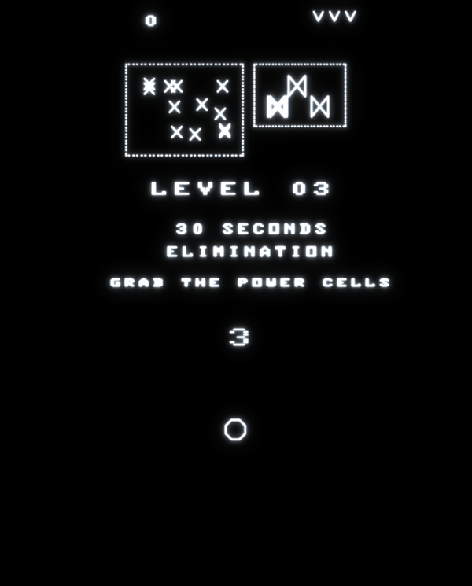
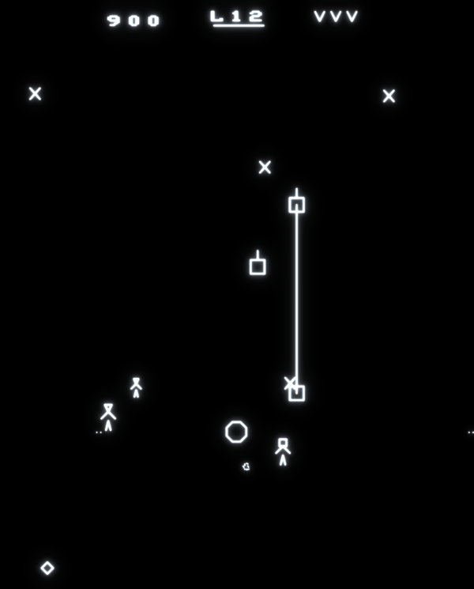
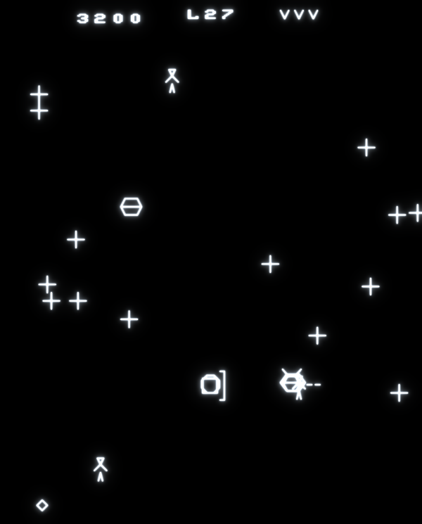

<h1 align="center">ROBOT ARENA</h1>

<b>An arena shooter for the Vectrex · 70 levels in two arenas · 4 bosses · 6809 assembly on a 64 KiB bank-switched cartridge</b>

---

**The year is 2084.** The robots built to serve mankind have turned on their makers. The last humans are herded into
the Arena, where wave after wave of robots hunts them down. You are the last hope: a lone fighter ship, fast, armed,
and alone. Fight through the four acts of the first Arena to the **Overseer**, the machine that runs it all. Beat it
and the last robots flee into **The Core**, the factory where they are built: Arena 2.

Robot Arena is a tribute to Williams' *Robotron: 2084* and to Thomas Sontowski's *Robot Arena*, made new for a real
Vectrex. It is written in 6809 assembly for a custom W27C512 cartridge, where the VIA's PB6 line drives EPROM address
line A15. That gives two 32 KiB banks:

* **Bank 1** holds the title, Arena 1, all the screens and the saves.
* **Bank 0** holds Arena 2, "The Core".

An optional DS2431 1-Wire chip keeps the high scores, the Arena 2 unlock, the difficulty and the KING titles through
power-off.

## Contents

[The robots in real life](#the-robots-in-real-life) · [How to play](#how-to-play) · [Screenshots](#screenshots) ·
[The cast](#the-cast) · [The bosses](#the-bosses) · [How the robots think](#how-the-robots-think) ·
[Behind the scenes](#behind-the-scenes)

---

## The robots in real life

What the vector robots would look like if they walked out of the screen. These are painted in the style of an
early-80s cartridge box: airbrushed chrome, a striped sunset and a glowing grid.

| | | | | |
|:-:|:-:|:-:|:-:|:-:|
|  |  |  |  |  |
|  |  |  |  |  |

---

## How to play

Switch the Vectrex on with the cartridge in. After the Vectrex logo the title shows the robots, the humans and the high
scores. **Button 4 plays**, button 2 changes the difficulty (EASY, MEDIUM, HARD) and button 1 opens the calibration
screen. Once Arena 1 has been finished, the joystick chooses **< ARENA 2 >**. Every game starts at level 1 with 3 ships
and 1 bomb.

| Control | Action |
|---|---|
| Joystick | Move. A small push moves slowly, a full push at full speed (about 3 px a frame). |
| Buttons 1 2 3 4 | Fire left, up, down and right. Two neighbouring buttons fire diagonally. |
| Hold a button | Autofire, about 7 shots a second. Every fresh press fires at once. |
| Hold all four buttons | **Bomb**: a shock wave rings out from the ship and sweeps the whole arena in two seconds. |

You move one way and shoot another, as in the arcade original.

### Kinds of level

* **Elimination:** destroy every robot. Hulks and electrodes don't count. The time left on the clock becomes the time
  bonus. When the clock runs out you still have to finish the job, without a bonus.
* **Survival:** stay alive until the clock runs out while robots keep coming in from the edges.
* **Swarm elimination:** a ring of crosses closes in from all sides. Swarm crosses take two hits each.
* **Boss:** a giant robot with its own weapons and a bar of hits under the clock.

Each level opens with its name and a hint while the robots wait in dotted cages at the top. After a countdown the cages
vanish and the robots burst out.

### Humans, ships and points

Touch a human to save it. The first is worth 1,000 points, then 2,000, 3,000 and 4,000, then 5,000 for every one after
that. The run resets when you lose a ship. Save every human of a level for the **savior bonus**. Hulks trample humans
and Brains turn them into Progs.

Anything that touches your ship destroys it, and the robot that rams you dies too. You win an extra ship every 50,000
points on EASY (100,000 on MEDIUM, 200,000 on HARD), up to 9. Destroying a Guardian or a Hydra earns an extra bomb.

### The campaign

**Arena 1:** 37 levels in four acts. Each act introduces its robots one at a time, mixes them with the ones you know,
twists the rules, and ends with a swarm or a boss.

| Act | Levels | Highlights |
|---|---|---|
| I · The arena awakens | 1-10 | crosses, hulks, bowties, the first swarm |
| II · The hunters | 11-20 | killers, brains, mine fields; boss: **the Guardian** |
| III · The factory | 21-30 | spheroids, quarks, tanks; the Guardian returns |
| IV · The Overseer | 31-37 | praetorians, everything at once; **the Overseer** |

**Arena 2, "The Core":** 33 levels in three acts: I The Foundry, II The Wires and III The Heart. It brings new robots,
laser fences, power cells, and **dark levels** lit only by lightning. Its bosses are the Hydra and the Architect.

Finishing Arena 1 on HARD crowns you **KING OF THE ARENA**, and Arena 2 on HARD **KING OF THE GALAXY**. Finishing on
EASY or MEDIUM, the game offers to raise the difficulty for your next game.

---

## Screenshots

From the game running on the emulator, played by its built-in test autopilot (invincible, so it can show the late levels).

| | | |
|:-:|:-:|:-:|
|  The title |  The title shows the robots |  A level starts: robots in their cages |
|  Crosses and Hulks |  A swarm ring closing in |  Act II: brains and killers |
|  Level 20: the Guardian and its crosses |  Act III: the factory robots |  Act IV: everything at once |
|  Level 37: the Overseer |  Arena 2: a level intro |  Laser fences |
|  Centipedes |  The Hydra |  The Architect builds a fence |

---

## The cast

Every sketch is drawn from the robot's real vector shape in the game, with its width on the screen in pixels. Next to it
is the shape as it glows on the Vectrex. Points are for EASY / MEDIUM / HARD. Anything that needs more than one hit
flashes when hit and is knocked back 2 px.

### Arena 1

<b>The fighter</b> (you). Fires in 8 directions. Shots fly at 6 px a frame for 45 frames, with at most 8 on screen. After a lost ship you come back with 2.4 s of safety, and robots near the start point are moved away.
 

<b>The humans</b> wander at about 12 px a second and pick a new direction every second or so. Touch one to save it.
 

<b>Cross</b> · 100 / 150 / 200 · 1 hit. The foot soldier. Each cross has its own pace, re-rolled now and then. It turns every few tenths of a second, 60 % of the time roughly toward you (exactly, or 45° off) and 40 % at random.
 

<b>Hulk</b> · no points · indestructible. It plods at half a pixel a step. Three times in four it heads for the nearest human and crushes it. Your shots shove it 3 px and interrupt its plans. Only a bomb destroys it, and a level doesn't need it gone.
 

<b>Small bowtie</b> · 200 / 300 / 400 · 2 hits. Switches between flapping (fast) and gliding (slow) and turns toward you half the time. About every 3.4 s it fires one aimed dot.
 

<b>Strong bowtie</b> · 5,000 / 7,500 / 10,000 · 20 hits. Tumbles slowly. Every 1-2 s it fires a fast double shot aimed <b>ahead of you</b>, up to 32 px in the direction your stick is pushed, plus a second shot on a random diagonal.
 

<b>Killer</b> · 150 / 250 / 300 · 1 hit. Closes in diagonally on a spot beside you (each one has its own offset) and <b>stays out of your four straight firing lines</b>. Fires homing arrows. Built by Spheroids.
 

<b>Brain</b> · 500 / 750 / 1,000 · 3 hits. Hunts the nearest human and turns it into a Prog on touch. Runs from you when you come within 44 px, and fires a homing missile every 4-6 s. With no humans left it charges you, and fires more often.
 

<b>Prog</b> · 100 / 150 / 200 · 1 hit. A human turned by a Brain. It walks straight at you and <b>lunges at double speed</b> in the last 48 px.
 

<b>Spheroid</b> · 1,000 / 1,500 / 2,000 · 1 hit. Zips around at 2 px a step and <b>flees</b> when you come close. Builds a Killer every 4.8 s (1.8 s in later acts), 4 of them (6 later on), then vanishes. Hunt it down first.
 

<b>Quark</b> · 1,000 / 1,500 / 2,000 · 1 hit. Even more erratic, at 3 px a step, and flees too. Builds Tanks a little more slowly than a Spheroid builds Killers.
 

<b>Tank</b> · 200 / 300 / 400 · 5 hits. Slow. Fires shells <b>led toward where you are going</b>. The shells bounce off the walls with a random kick each time, so they never repeat a path, and live 2.4-5 s.
 

<b>Mine layer</b> · 300 / 450 / 600 · 3 hits. Wanders and drops one of its 7 electrodes every second or so, then scuttles away from you.
 

<b>Electrode</b> · 30 / 50 / 60 · 1 hit. A mine. It never moves, kills on contact, and doesn't count for the clear.
 

<b>Praetorian</b> · 500 / 750 / 1,000 · 4 hits. The elite guard of the late levels. Charges straight at you, faster sideways than up and down, and fires an aimed spark every 0.8 s.
 

### Arena 2

<b>Splitter and shards</b> · 150 / 50 (EASY). Weaves toward you. Shot, it bursts into two shards that fly off sideways, then turn back and home in, one 45° step at a time.
 

<b>Shield bot</b> · 300 / 450 / 600. Turns its shield toward you every 0.6 s. A shot within 45° of straight into the shield bounces off; one shot in the side kills it.
 

<b>Phaser</b> · 250 / 400 / 500. Visible for 1.5-2 s, fires one led shot, then <b>phases out and reappears 64 px from you</b>. It is harmless and can't be hit while it materialises.
 

<b>Sniper</b> · 200 / 300 / 400. Walks to a spot away from you and locks an aiming line on where you are. After a second it fires along that line at 7 px a frame. It never re-aims, so stepping aside is enough.
 

<b>Orbiter</b> · 200 / 300 / 400. Circles your ship once every 2.6 s, its orbit breathing between 64 and 22 px. It never shoots; it just has to touch you.
 

<b>Laser fence</b> · 200 / 300 / 400. Two posts and a deadly beam: lit 2.6 s, dark 1.4 s, flickering just before it lights. Some sweep across the arena. Shoot a post to break it.
 

<b>Centipede</b> · 100 / 150 / 200 a segment. A head and up to 8 segments that each follow 7 px behind the one ahead. Shoot a middle segment and the segment behind becomes a new head: <b>two centipedes</b>.
 

**Power cells** (Arena 2): every 15th robot you destroy drops a cell that lasts 8 s. It gives one of three powers:

* **Rapid fire:** double rate, 10 s.
* **Triple shot:** two extra shots at ±45°, 10 s.
* **Shield:** takes one hit.

Active powers show as cards bottom right. **Dark levels** show robots only within about 42 px of your ship, until the
lightning lights everything for a moment.

---

## The bosses

<b>The Guardian</b> (levels 20 and 30) · 25,000 / 37,500 / 50,000. A hexagonal core behind <b>eight armour plates</b> of 14 hits each, then the open core: 44 hits, or 50 the second time. It roams, keeps off your firing lines, and sidesteps shots that would hit it. It runs a fixed cycle of attacks: 4-way volleys straight and diagonal, a spawn of a homing missile, a mine and 2 crosses, and a <b>shield</b> that bounces your shots and regrows a lost plate. It also drops a mine every 2.6 s.
 

<b>The Overseer</b> (level 37). The machine that runs the Arena: six phases, 262 hits on its eye in all, and points for every hit. It changes attack every 8 s and at every phase change, dropping a mine and clearing the screen each time. Its six attacks: a 4-way volley, an 8-way spread, bouncing shells, crosses, homing missiles, and a faster spread. Destroying it is worth 50,000 / 75,000 / 100,000. A bomb takes 10 hits off it.
 

<b>The Hydra</b> (Arena 2 levels 11 and 22) · 25,000 / 37,500 / 50,000. A head dragging 5 rings (7 the second time). <b>Only the glowing tail ring takes damage</b>, 7 hits, and then the next ring becomes the tail. Shots elsewhere bounce off. It fires 3-way volleys. With its body gone the head opens and <b>rages</b>: twice as fast, 5-way volleys, 30-36 hits to finish it. The second Hydra also spits shards.
 

<b>The Architect</b> (the final level) · three phases of 40, 45 and 50 hits. It builds <b>sweeping laser fences</b> right over you and fires 3-way volleys. From phase 2 it teleports, fading out and coming back with an 8-way ring of sparks and an orbiter. In phase 3 it locks an aiming line on you before a fast 3-shot burst. Worth 50,000 / 75,000 / 100,000.
 

---

## How the robots think

The rules every robot shares, taken from the game's source:

* **Think rate is the difficulty.** The game runs at 50 frames a second, but a robot gets an "AI turn" on only
  **70 % of the frames on EASY, 88 % on MEDIUM and 110 % on HARD**, spread evenly over the robots. Shots, fences and
  centipedes always move at full speed. So on HARD the robots really are faster and fire sooner, while the bullets stay
  fair.
* **Each level has a tier** (0-7) in the campaign table. It speeds up fire rates, shot speeds, factory build times and
  missile steering, independently of the difficulty.
* **A shot cap:** robots may have 4 to 12 shots on screen, rising with the tier, minus 2 on EASY and 1 on MEDIUM. A
  robot whose turn to fire comes while the screen is full just skips it.
* **Dodging:** killers, brains, spheroids, quarks, tanks, mine layers, praetorians, splitters and phasers watch your
  trigger. While you hold a fire button, a dodging robot standing in your firing line, ahead of you and within about
  10 px of it, steps 2 px aside.
* **Homing missiles** steer every 8th frame (every 4th later on), nudging each axis 0.3 px/frame toward you, capped at
  1.5. They live 4 s, so they can be outrun or made to overshoot.
* **Every enemy shot can be shot down,** for a few points. When your ship dies, every enemy shot on screen disappears.
* **The cage burst:** for the first second after the cages open, each robot shoots outward in a direction taken from
  its slot number. Then its own logic takes over.
* **Swarm rings** start on a squarish ring around you. Every 4 frames each cross re-aims at you, and the ring speeds up
  over the first 15 seconds to nearly your top speed.
* **Survival levels** bring in one robot every 1-1.4 s from a random edge: the level's featured robot three times in
  four, a cross otherwise. Spawning pauses while 30 robots are on screen. When the clock runs out, everything left
  explodes.

---

## Behind the scenes

* **The hardware:** a W27C512 EPROM with PB6 on A15.
  * Bank switches happen only between screens.
  * The code that runs during a switch, the 1-Wire driver included, sits at the same addresses in both banks. The build
    checks those bytes, because a low PB6 also selects bank 0.
  * The DS2431 save chip is optional. It keeps two copies of a 64-byte record, written at the end of each game and after
    calibration.
* **The frame budget:** the game stays inside the Vectrex's 30,000-cycle frame most of the time. The design rule is
  fewer, smarter robots rather than many dumb ones.
* **Balancing** used simulations: a bot plays every level many times inside a cycle-exact emulator, at three skill
  levels. Real play sessions were recorded, replayed and compared with it, so the targets could be set from how a real
  player does.
* **The calibration screen** trims the Vectrex's zero reference. Every real console drifts a little, and the game lets
  you straighten your own.

Robot Arena · a Vectrex homebrew by Hugo Bokhorst · 2026

